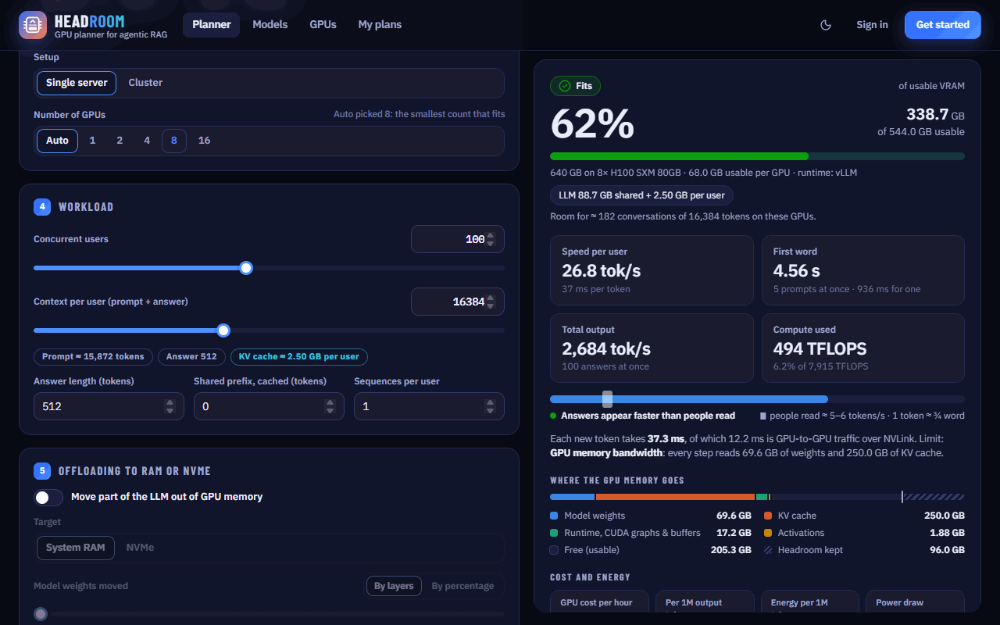
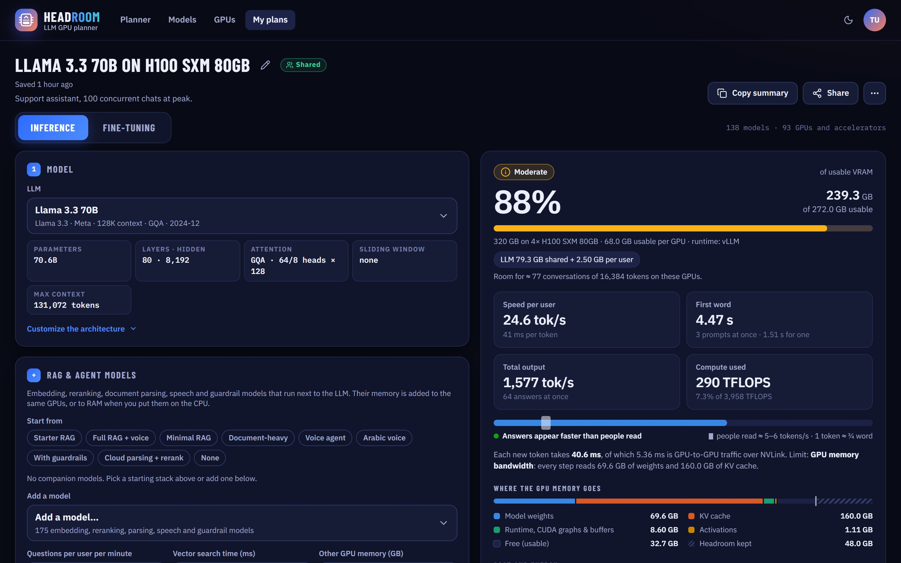
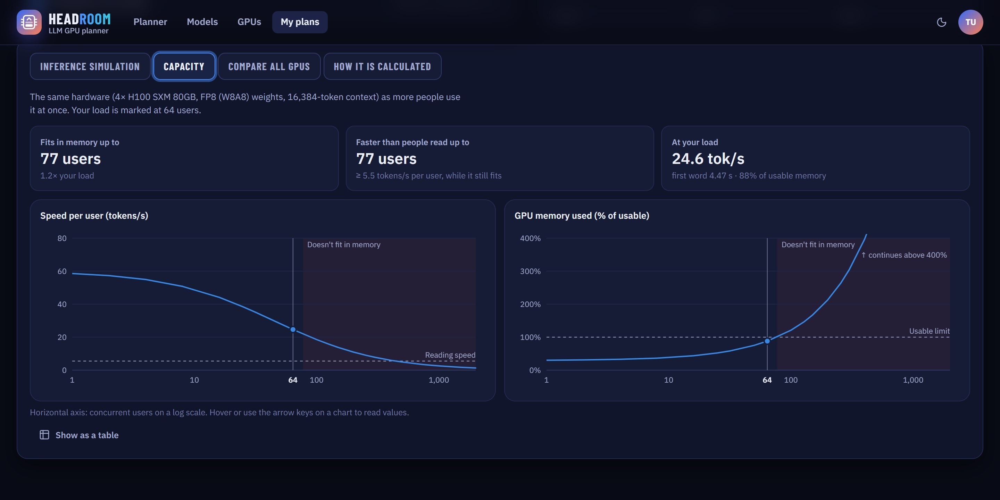
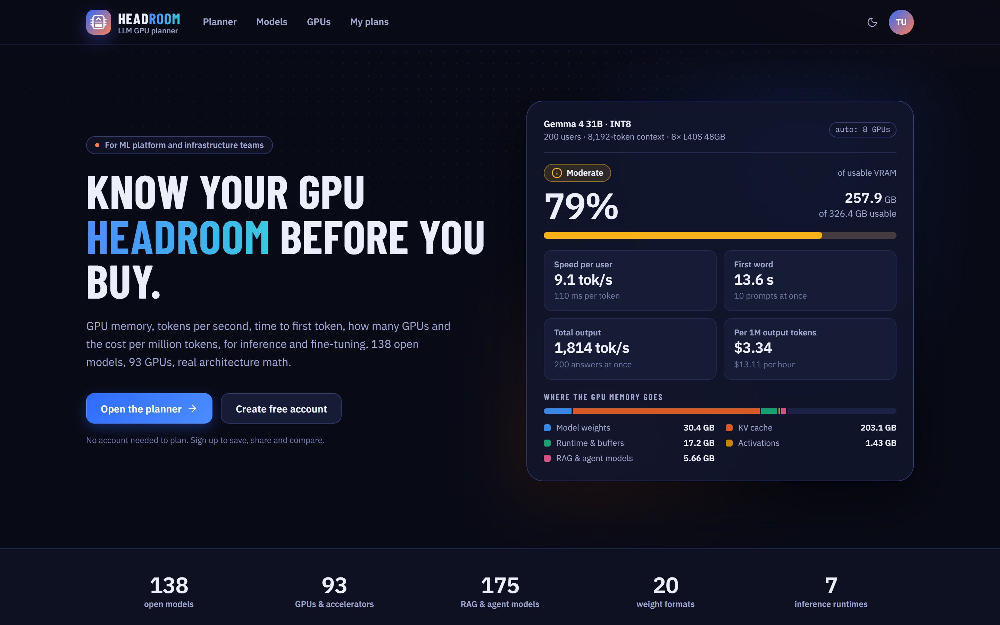
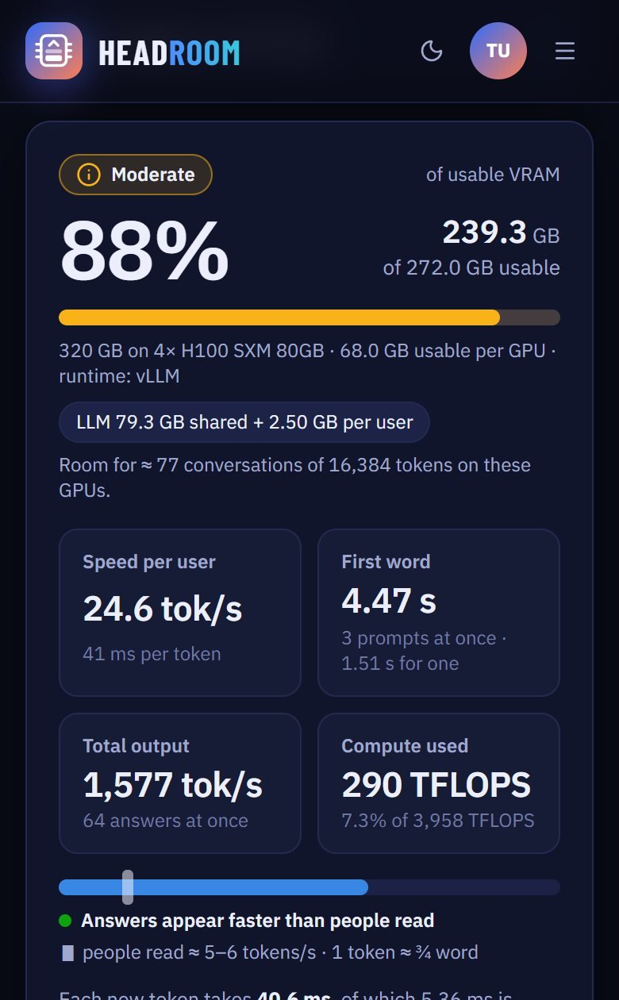
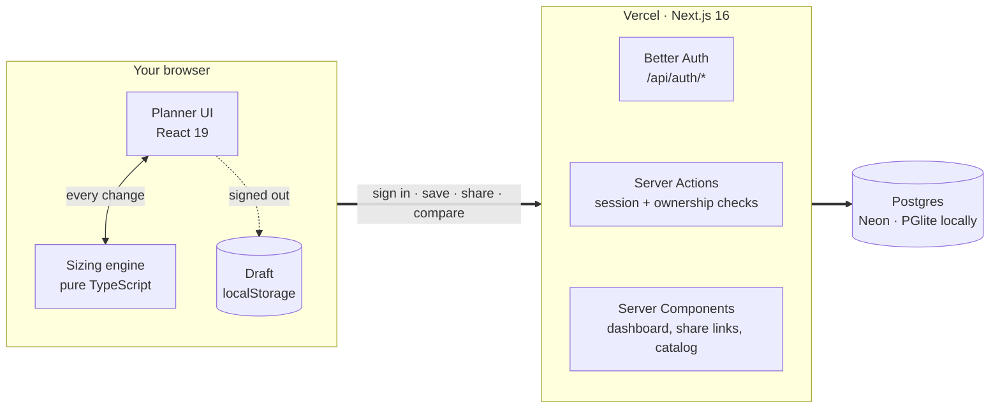

<div align="center">



### Plan GPU memory, tokens/s, first-token latency, GPU count and cost for any open LLM, before you buy a single card.

<p>
  <a href="https://nextjs.org"></a>
  <a href="https://react.dev"></a>
  <a href="https://www.typescriptlang.org"></a>
  <a href="https://tailwindcss.com"></a>
  <br>
  <a href="https://www.better-auth.com"></a>
  <a href="https://orm.drizzle.team"></a>
  <a href="https://neon.tech"></a>
  <a href="https://vitest.dev"></a>
  <a href="LICENSE"></a>
  <a href="https://github.com/zakaria-hamane/HEADROOM/actions/workflows/ci.yml"></a>
</p>

<p>
  
  
  
  
  
</p>

<a href="https://vercel.com/new/clone?repository-url=https%3A%2F%2Fgithub.com%2Fzakaria-hamane%2FHEADROOM&project-name=headroom&repository-name=headroom&env=BETTER_AUTH_SECRET&envDescription=A%20random%20string%20of%2032%2B%20characters%20that%20signs%20sessions&envLink=https%3A%2F%2Fgithub.com%2Fzakaria-hamane%2FHEADROOM%23environment-variables&stores=%5B%7B%22type%22%3A%22integration%22%2C%22integrationSlug%22%3A%22neon%22%2C%22productSlug%22%3A%22neon%22%2C%22protocol%22%3A%22storage%22%7D%5D"></a>

<p>
  <a href="#see-it">See it</a> ·
  <a href="#features">Features</a> ·
  <a href="#a-real-answer">A real answer</a> ·
  <a href="#quick-start">Quick start</a> ·
  <a href="#deploy-to-vercel">Deploy</a> ·
  <a href="#how-it-works">How it works</a> ·
  <a href="#contributing">Contributing</a> ·
  <a href="#license">License</a>
</p>



<sub>Raise the users and Headroom adds GPUs until the model stops fitting, then streams an answer at the speed it computed.</sub>

</div>

---

**Does it fit? Is it fast enough? What does it cost?** Those are the three questions behind every GPU purchase for an LLM, and spreadsheets answer them badly. Headroom answers all three as you type: pick a model, a precision, a GPU and a workload, and see exactly where every gigabyte of VRAM goes, how fast answers stream to each user, how long the first word takes under a burst, how many GPUs you actually need and what a million tokens will cost you.

It works for **inference and fine-tuning**, single servers and **TP × PP × DP clusters**, RAG and agent stacks that share the GPU, and offloading to RAM or NVMe. Make an account to save plans, share them with a link and compare them side by side.

> [!TIP]
> No account is needed to plan. Drafts stay in your browser, and signing up saves them to your account.

If Headroom saves you from buying the wrong GPUs, **a ⭐ on this repo helps other people find it.**

## See it

<p align="center">
  <picture>
    <source media="(prefers-color-scheme: dark)" srcset="docs/planner.jpg">
    <source media="(prefers-color-scheme: light)" srcset="docs/planner-light.jpg">
    
  </picture>
  <br>
  <sub><b>The planner.</b> Every input updates the result instantly: memory meter, speed against reading speed, and a breakdown of where the GPU memory goes. It follows your light or dark theme, and so does this image.</sub>
</p>

<table>
  <tr>
    <td width="50%" valign="top">
      
      <p><b>Inference simulation.</b> Watch an answer stream at the computed speed, with what a person has read so far highlighted, next to a live view of every concurrent user.</p>
    </td>
    <td width="50%" valign="top">
      
      <p><b>Capacity.</b> How the same hardware behaves as users grow: where it stops fitting and where answers fall below reading speed.</p>
    </td>
  </tr>
  <tr>
    <td width="50%" valign="top">
      
      <p><b>Compare all GPUs.</b> Your workload on all 93 GPUs at the smallest count that fits, sortable by speed, latency, $/hour or $ per 1M tokens.</p>
    </td>
    <td width="50%" valign="top">
      
      <p><b>My plans.</b> Saved plans with their headline numbers, filters, stars and sharing, plus templates for common setups.</p>
    </td>
  </tr>
  <tr>
    <td width="50%" valign="top">
      
      <p><b>Landing page.</b> A real result from the engine, the catalog at a glance and the methodology.</p>
    </td>
    <td width="50%" valign="top" align="center">
      
      <p><b>On a phone.</b> The full planner, with a sticky result bar that jumps to the numbers.</p>
    </td>
  </tr>
</table>

## Features

<table>
  <tr>
    <td width="33%" valign="top">
      <h4>Size it</h4>
      <ul>
        <li><b>Planner</b>: model, RAG/agent stack, precision and runtime, hardware, workload, offloading and cost settings</li>
        <li><b>Auto GPU count</b> on a single server, or clusters with tensor, pipeline and data parallelism</li>
        <li><b>Offloading</b> of layers or KV cache to RAM or NVMe, run on the CPU or copied over PCIe</li>
        <li><b>Fine-tuning</b>: full, LoRA and QLoRA, optimizers, ZeRO-1/2/3, checkpointing, training time and cost</li>
      </ul>
    </td>
    <td width="33%" valign="top">
      <h4>Understand it</h4>
      <ul>
        <li><b>Memory breakdown</b>: weights, KV cache, runtime and CUDA graphs, activations, companions, free and kept headroom</li>
        <li><b>Speed per user</b> against human reading speed, <b>first word</b> under a burst, total throughput, compute used</li>
        <li><b>Cost and energy</b>, server CPU and RAM, and plain-language warnings</li>
        <li><b>How it is calculated</b>: every formula with your numbers plugged in</li>
      </ul>
    </td>
    <td width="33%" valign="top">
      <h4>Keep it</h4>
      <ul>
        <li><b>Accounts</b>: email and password, password reset, optional GitHub and Google sign-in, sessions you can sign out remotely</li>
        <li><b>Saved plans</b>: autosave, rename, star, duplicate, export JSON, import setup codes</li>
        <li><b>Share links</b> you can turn on and off; viewers can save their own copy</li>
        <li><b>Compare plans</b>: up to four side by side, best value per row marked</li>
      </ul>
    </td>
  </tr>
</table>

Plus a searchable **catalog** with a page per model (weights per format, KV cache per user, smallest setup on popular GPUs), **templates** for common setups, light and dark themes, keyboard support and a mobile layout.

## A real answer

One of the saved plans in the screenshots: a support assistant on **Llama 3.3 70B** in FP8, **64 people chatting at once** with a 16K-token context, on **4× H100 SXM 80GB**.

| Question | Headroom's answer |
| --- | --- |
| Does it fit? | **Yes, at 88%** of usable VRAM: 239.3 of 272.0 GB. Room for about 77 conversations. |
| Where does the memory go? | 69.6 GB of weights, **160.0 GB of KV cache** (2.50 GB per user), 8.6 GB runtime, 1.1 GB activations |
| Is it fast enough? | **24.6 tokens/s per user**, about 4× faster than people read. 40.6 ms per token, 5.36 ms of it NVLink traffic. |
| How long until the first word? | **1.51 s** for one prompt, **4.47 s** when 3 arrive at once |
| How far does it scale? | Fits and stays faster than reading up to **77 users** (1.2× this load) |
| What does it cost? | **$4.77 per 1M output tokens** at typical cloud rates |
| Is there something cheaper? | *Compare all GPUs* ranks a single **AMD MI350X 288GB** first at **$1.77 per 1M tokens** for the same workload |

The KV cache is the part people underestimate. Per user it is

```math
\underbrace{2}_{K,\,V} \times \underbrace{80}_{\text{layers}} \times \underbrace{8}_{\text{KV heads}} \times \underbrace{128}_{\text{head dim}} \times \underbrace{16{,}384}_{\text{tokens}} \times \underbrace{1\ \text{byte}}_{\text{FP8}} = 2.50\ \text{GiB}
```

so 64 users need 160 GB of KV cache, more than twice the weights. Generation is bound by memory bandwidth: every new token reads all the weights plus every user's KV cache, which is why speed per user falls as users grow.

## Quick start

Requires Node.js 22.9 or newer.

```bash
git clone https://github.com/zakaria-hamane/HEADROOM.git
cd HEADROOM
npm install
npm run dev
```

Open http://localhost:3000. That's all: without `DATABASE_URL`, accounts and plans live in an embedded Postgres ([PGlite](https://pglite.dev)) in `./.data`, created and migrated on first use. Password-reset links are printed in the terminal.

To use a real Postgres locally, copy `.env.example` to `.env.local`, set `DATABASE_URL`, then run `npm run db:migrate`.

## Deploy to Vercel

**One click:** the **Deploy with Vercel** button above clones the repository, asks for `BETTER_AUTH_SECRET` and offers to add a Neon Postgres database.

**Or by hand:**

1. **Import the repository** in Vercel (Add New → Project). `vercel.json` sets the build command to `npm run vercel-build`, which applies database migrations and then builds.
2. **Add a database**: Storage → Create Database → **Neon (Postgres)**, connected to the project. This sets `DATABASE_URL`.
3. **Add the auth secret**: Settings → Environment Variables → `BETTER_AUTH_SECRET`, 32+ random characters, for Production and Preview. `npm run auth:secret` prints one.
4. **Deploy** (or redeploy after adding the variables). The build log shows `[migrate] Postgres database is up to date.`

The production, branch and preview URLs can sign in automatically. For a custom domain that isn't the project's primary domain, set `BETTER_AUTH_URL` (or list extra hosts in `AUTH_ALLOWED_HOSTS`).

> [!NOTE]
> Without a database the site still deploys: the planner and catalog work, and sign-up explains that accounts aren't set up yet.

<details>
<summary><b>Optional: GitHub and Google sign-in, password-reset emails</b></summary>

<br>

- **GitHub sign-in**: create an OAuth app with callback `https://<your-domain>/api/auth/callback/github`, then set `GITHUB_CLIENT_ID` and `GITHUB_CLIENT_SECRET`.
- **Google sign-in**: create OAuth credentials with redirect URI `https://<your-domain>/api/auth/callback/google`, then set `GOOGLE_CLIENT_ID` and `GOOGLE_CLIENT_SECRET`.
- **Password-reset emails**: set `RESEND_API_KEY` and `EMAIL_FROM` (a sender on a domain verified in Resend). Without them, "Forgot password" is hidden in production.

</details>

## How it works



- **The math runs in your browser.** The sizing engine is a set of pure functions, so results update on every keystroke with no server round trip.
- **The server keeps what you save.** Server Actions re-check the session and scope every read and write to the plan's owner, and validate and size-limit plan state before storing it.
- **One codebase, two databases.** Production uses Postgres on Neon through a pooled `pg` client; local development falls back to an embedded PGlite database with the same migrations.

| Layer | Choice |
| --- | --- |
| Framework | Next.js 16 (App Router, Cache Components, Server Actions, Turbopack) |
| UI | React 19, Tailwind CSS 4, Radix UI, lucide icons, sonner toasts |
| Auth | Better Auth: database sessions, rate limiting stored in Postgres, origin checks |
| Data | Drizzle ORM, PostgreSQL (Neon), PGlite for local development |
| Validation | Zod |
| Tests | Vitest |

### A parity-tested engine

The engine in `src/lib/engine` is a line-by-line TypeScript port of the original single-file *LLM GPU Planner*. `tests/engine.parity.test.ts` runs randomized settings for every model through both engines and requires **identical results** for inference, the GPU-count search, the all-GPU comparison, fine-tuning and every companion model. `tests/planner.test.ts` checks the planner wrapper, state validation, setup-code compatibility and that every template fits.

> [!IMPORTANT]
> These are planning estimates, not measurements. Memory is in GB = GiB (2³⁰ bytes), as nvidia-smi reports it; bandwidth is decimal GB/s and compute is dense TFLOPS. Check with a load test on the target hardware before you buy.

## Reference

### Environment variables

| Variable | Required | Purpose |
| --- | --- | --- |
| `DATABASE_URL` | Production | Postgres connection string (`POSTGRES_URL` is also accepted). Unset locally = embedded database. |
| `BETTER_AUTH_SECRET` | Production | Signs sessions. 32+ random characters. |
| `BETTER_AUTH_URL` | No | Public URL, when it isn't one of the project's Vercel URLs. |
| `AUTH_ALLOWED_HOSTS` | No | Extra hostnames allowed to sign in, comma separated. |
| `GITHUB_CLIENT_ID` / `GITHUB_CLIENT_SECRET` | No | GitHub sign-in. |
| `GOOGLE_CLIENT_ID` / `GOOGLE_CLIENT_SECRET` | No | Google sign-in. |
| `RESEND_API_KEY` / `EMAIL_FROM` | No | Password-reset emails. |
| `DATABASE_POOL_MAX` | No | Postgres pool size per function instance (default 5). |

<details>
<summary><b>Scripts</b></summary>

<br>

| Script | What it does |
| --- | --- |
| `npm run dev` | Development server. |
| `npm run build` / `npm start` | Production build and server. |
| `npm run vercel-build` | Migrations, then build (used by Vercel). |
| `npm run check` | Type-check, lint and tests. |
| `npm test` | Engine parity and planner tests. |
| `npm run db:generate` | New SQL migration after changing `src/db/schema.ts`. |
| `npm run db:migrate` | Apply migrations to `DATABASE_URL`, or to the embedded database. |
| `npm run db:studio` | Browse the database with Drizzle Studio. |
| `npm run auth:secret` | Print a random `BETTER_AUTH_SECRET`. |

</details>

<details>
<summary><b>Project layout</b></summary>

<br>

```
src/
  app/
    (marketing)/          landing page
    (auth)/               sign-in, sign-up, forgot/reset password
    (app)/                planner, plans/[id], share/[shareId], dashboard, compare, settings, models, gpus
    actions/plans.ts      Server Actions for saved plans (every action checks the session and ownership)
    api/auth/[...all]     Better Auth endpoints
  components/
    brand/                the Headroom logo, mark and wordmark
    planner/              the planner workspace: cards, results, simulation, capacity, compare, dialogs
    dashboard/ settings/ auth/ catalog/ marketing/ layout/ ui/
  data/catalog.json       models, GPUs and companion models
  db/                     Drizzle schema and connection (Postgres or embedded PGlite)
  lib/
    engine/               the sizing engine (pure functions)
    planner/              state, defaults, templates, run logic, formulas, formatting
    auth.ts, session.ts   Better Auth configuration and server-side session helpers
  proxy.ts                redirects signed-out visitors away from private pages
drizzle/                  SQL migrations
scripts/migrate.mjs       migration runner used locally and on Vercel
tests/                    Vitest suites; fixtures/original-engine.cjs is the original engine, kept for parity tests
docs/                     README banner, logo, demo GIF, social preview and screenshots
.github/                  CI workflow, issue and pull request templates
```

</details>

<details>
<summary><b>Security notes</b></summary>

<br>

- Sessions are database-backed cookies (30 days, refreshed daily). Signing out elsewhere and password resets take effect immediately.
- Sign-in, sign-up and password-reset endpoints are rate limited in production, with limits stored in Postgres so they hold across serverless instances. Requests from other origins are rejected.
- Every Server Action re-checks the session and scopes reads and writes to the plan's owner. Plan state from clients is validated and size-limited before it is stored.
- Share links use random 12-character IDs and work only while sharing is on.

</details>

<details>
<summary><b>Customizing</b></summary>

<br>

- Name, tagline and URL: `src/lib/site.ts`.
- Logo: `src/components/brand/logo.tsx`, `src/app/icon.svg`, `public/logo.svg`.
- Colors and fonts: tokens at the top of `src/app/globals.css`.
- Templates: `src/lib/planner/templates.ts`. RAG presets and defaults: `src/lib/planner/defaults.ts`.
- Catalog: `src/data/catalog.json` (same format as the original tool's embedded data).

</details>

## Contributing

Contributions are welcome, and the most valuable ones don't need code:

- **Measured a real setup?** [Open an issue](https://github.com/zakaria-hamane/HEADROOM/issues/new?template=bug-report.yml) with the setup code and what you measured. Real numbers are how the estimates get better.
- **Missing a model or GPU?** [Request it](https://github.com/zakaria-hamane/HEADROOM/issues/new?template=model-or-gpu.yml), or add it to `src/data/catalog.json` yourself.
- **Want to code?** Start with [CONTRIBUTING.md](CONTRIBUTING.md): setup takes two commands and no database.

<a href="https://star-history.com/#zakaria-hamane/HEADROOM&Date">
  <picture>
    <source media="(prefers-color-scheme: dark)" srcset="https://api.star-history.com/svg?repos=zakaria-hamane/HEADROOM&type=Date&theme=dark">
    
  </picture>
</a>

## License

Headroom is open source under the [GNU Affero General Public License v3.0](LICENSE) (`AGPL-3.0-only`).

- **Use it freely**: run it, study it, modify it and self-host it, at home or at work.
- **Share what you serve**: if you run a modified version that other people use over a network, you must offer them its complete source code under the same license. Every page footer links to the source, so keep that link pointing at your version.
- **Need other terms?** Commercial licenses without the AGPL obligations are available from [the maintainer](https://github.com/zakaria-hamane).

The license covers the code, not the Headroom name or logo: please give forks their own name.

---

<div align="center">
  
  <br>
  <sub><b>Headroom</b> · know your GPU headroom before you buy · <a href="#top">back to top</a></sub>
</div>
